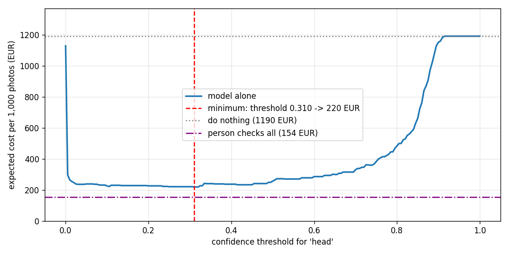

# Assignment 2 Report

- **Name**: Miguel Gordon
- **Student ID**: 20120
- **Email**: mgordon.ieu2022@student.ie.edu
- **Group**: BBADBA 5B

## Business problem, and the cost of being wrong

**The decision.** On a construction site, wearing a hard hat is the worker's responsibility, but in practice the person who enforces it is the site manager, who walks around the site and tells anyone without a hard hat to put it on. It is not one of the site manager's core tasks, yet it is one of the ones that wastes most of their time, and walking around only covers the people they happen to pass. The model replaces that walk with cameras: it looks at each camera photo and decides whether someone in it is not wearing a hard hat.

**Who acts on it.** The site has 15 fixed cameras that take one photo every 10 minutes. Each photo ends in one of three outcomes:

- **Alert**: the site manager is notified, goes to the spot and makes the worker put the hard hat on.
- **Human review**: a security guard who is already on site checks the photo on a screen and decides whether to alert the site manager.
- **Pass**: no action.

**Why one mistake is much worse than the other.** Missing someone without a hard hat (a false negative) leaves a person exposed to a head injury. In the worst case that is a serious, permanent injury and the company is liable for it. A false alarm (a false positive) only costs the site manager three or four minutes walking over to check. In euros (justified in the cost section), a missed photo costs about **17 EUR** and a false alarm about **1.1 EUR**, so a miss is roughly 15 times worse. The rest of the report follows from that asymmetry: the metric that matters is recall on bare heads, the threshold is chosen by expected cost rather than accuracy, and a person stays in the loop to catch what the model misses.

## Dataset

- **Roboflow Universe**: workspace `joseph-nelson`, project `hard-hat-workers`, **version 5** (`raw_HeadHelmetClasses`), used as is, not forked. https://universe.roboflow.com/joseph-nelson/hard-hat-workers
- **Task**: object detection, 2 classes: `head` (a head **without** a hard hat) and `helmet` (a head with a hard hat). Version 5 drops the `person` class of the original dataset.
- **Positive class**: `head`. It is the case of risk that must trigger the alert.
- **What one case is**: one camera photo. A photo is positive if at least one person in it is not wearing a hard hat. The model's score for a photo is its highest `head` confidence in that photo, so the business decision is a clean 2x2 (alert or not) on whole photos.

The dataset serves the problem directly rather than just resembling it: it labels exactly the thing the site manager is looking for (heads with and without a hard hat) in construction settings.

## What the dataset's composition implies

| Split | Images | `head` instances | Images with a `head` | `helmet` instances | Images with a `helmet` |
|---|---|---|---|---|---|
| train | 4,916 | 4,612 | 911 (18.5%) | 13,919 | 4,503 (91.6%) |
| valid | 1,413 | 1,339 | 256 (18.1%) | 3,913 | 1,297 (91.8%) |
| test | 706 | 726 | **140 (19.8%)** | 1,915 | 636 (90.1%) |

Object size (side of the box relative to the side of the image): the median `head` is 7.8% of the image side, and 13.8% of `head` boxes are small (under ~32 px at 640 px). Images are internet photos of roughly 500x330 px, most of them close-ups.

What this implies:

- **Class balance.** There are three times more `helmet` than `head` instances. The class that matters for the business is the minority one, so an average over both classes flatters the model.
- **The headline number rests on 140 photos.** Only 140 test photos contain someone without a hard hat. Each one moves photo-level recall by 0.7 points, and at the measured 91.4% the 95% interval is roughly 87% to 96%. The recall I report is an approximation; a larger test set would be needed to pin it down.
- **The splits are consistent with each other but not with production.** The share of photos with a bare head is 18-20% in all three splits, so the test split is a fair sample of the dataset. But it is not a sample of my site: the photos are close-ups from the internet, whereas a fixed camera is high up and far away, so almost every head would be small. Small and distant heads are exactly where the model fails (see failure modes), so **recall on real site cameras will be lower than the 91% measured here.**
- **The base rate is not the production base rate.** 19.8% of test photos contain a bare head. On a real site, where workers are informed and know the risk of not wearing a hard hat, it should be much rarer. I therefore reweight all costs to my own base rate (7%, see cost section).

## Finetuning and baselines

**Model.** `yolo11n` (detection), finetuned from the COCO checkpoint. Detection rather than classification, because the decision depends on finding small heads anywhere in a wide scene. The nano model is enough for one photo every 10 minutes per camera.

**Training.** Google Colab, Tesla T4 GPU. 50 epochs, image size 640, batch 32, patience 15, seed 0 (about 1.1 hours). The pipeline is `uv run python main.py train` (`train.py`); the committed `weights/best.pt` comes from that configuration.

**Results on the same test split (706 photos, 140 positive), photo level.** The trivial and COCO rows are the two baselines required by the brief. COCO has no `head` or `helmet` class, so its box-level AP for my classes is 0 by definition; the most it can do zero-shot is alert whenever it sees a `person`.

| Approach | Box AP50 `head` | Detected (of 140) | False alarms (of 566) | Accuracy | Photo-level AP | Lowest expected cost per 1,000 photos |
|---|---|---|---|---|---|---|
| Trivial: never alert | 0 | 0 | 0 | 80.2% | 0.198 | 1,190 EUR |
| COCO yolo11n zero-shot (alert on `person`) | 0 | 140 | 552 | 21.8% | 0.291 | 855 EUR |
| **Finetuned yolo11n** | **0.967** | **128** | **13** | **96.5%** | **0.931** | **220 EUR** |

(Detected, false alarms and accuracy at YOLO's default 0.25 threshold; the cost column uses each approach's own best threshold.)

- **The trivial baseline shows why accuracy is the wrong metric here.** It never alerts and still scores 80% accuracy, simply because 80% of photos have nobody without a hard hat. It catches zero cases.
- **The COCO baseline catches everyone but is useless in practice.** It raises 552 false alarms out of 566 safe photos. Every alarm sends the site manager to the spot, wasting their time and the workers' time, and after a few days nobody would take the alerts seriously.
- **The finetuned model beats both by a wide margin**, on every metric and on cost (220 EUR per 1,000 photos against 855 and 1,190). The gap is as large as expected: the baselines cannot tell a bare head from a hard hat at all.

## Per-class evaluation and failure modes

**Box level, test split:**

| Class | Precision | Recall | AP50 | mAP50-95 |
|---|---|---|---|---|
| **`head` (positive: no hard hat)** | 0.943 | 0.929 | 0.967 | 0.674 |
| `helmet` | 0.956 | 0.947 | 0.983 | 0.685 |
| Mean of both | 0.949 | 0.938 | 0.975 | 0.679 |

The class that carries the business case is `head`, and it is the weaker of the two. The 0.975 mean is pulled up by `helmet`, the class that means everything is fine, so it overstates the performance on what matters.

**Photo level at the chosen threshold (0.31), test split:**

| | Alert | No alert |
|---|---|---|
| Someone without a hard hat (140) | 128 (TP) | 12 (FN) |
| Nobody without a hard hat (566) | 12 (FP) | 554 (TN) |

**Box-level confusion matrix** (test split, detections with confidence above 0.31): see `results/confusion_matrix_boxes_test.csv` and `results/confusion_matrix_boxes_test.png`, also shown in the dashboard.

<!-- TODO: fill in from results/confusion_matrix_boxes_test.csv after re-running the pipeline -->

**Where it fails** (`results/failures_false_negatives.png`, `results/failures_false_positives.png`):

- **Missed photos (false negatives)** are all small, hidden or unusual heads: drivers inside the cab of a loader or excavator (small and behind glass), a person lying on a stretcher (a pose that barely appears in training), bare heads at the back of large groups, and a small worker partly hidden on a building facade. In most of them the model's `head` score is 0: it does not see the head at all. The further away the person, the harder it is.
- **False alarms (false positives)** are mostly not model errors. Comparing with the ground truth shows people who really are not wearing a hard hat but were never labelled: men in suits visiting the site, someone in a military cap, a politician at a podium. For my business they **should** trigger an alert: anyone on site without a hard hat is a liability for the company if there is an accident, worker or visitor. So part of the measured false alarms are correct alerts, and **the real precision is better than the measured one**.

## Cost matrix and operating point

**Costs (euros per photo):**

| Outcome | Cost | Where it comes from |
|---|---|---|
| False negative | **17.0** | Expected accident cost plus expected fine (below). |
| False positive | **1.1** | 3.5 minutes of the site manager. 15 EUR/h gross plus ~30% employer social security = 19.5 EUR/h. |
| True positive | **1.5** | 4.5 minutes: the site manager goes and also corrects the worker. |
| True negative | 0 | Nothing happens. |

**How the 17 EUR false negative is built.** It is an expected cost, because almost always nothing happens:

- *Accident.* Without any control, I assume one head accident per year on this site. 4 in 10 would be serious (about 500,000 EUR, e.g. permanent injury) and 6 in 10 minor (about 20,000 EUR in sick leave, replacement and investigation), so 212,000 EUR on average. The site produces about 12,600 photos a year with someone bare-headed (see base rate), so each one carries 212,000 / 12,600 ≈ 17 EUR of accident risk.
- *Fine.* One labour inspection a year, a 25% chance it ends in a fine rather than a warning, and a fine of 10,000 EUR (within the range for a serious occupational-safety infringement under the LISOS). That is 2,500 EUR a year, or 0.2 EUR per photo.

These assumptions are deliberately on the pessimistic side, because underestimating the risk of a serious head injury is worse than overestimating it. The fine barely matters: the system is justified by protecting people, not by avoiding sanctions.

**Base rate: 7%.** A photo shows about 7 people on average. If each worker goes without a hard hat 1% of the time, the chance that at least one in a photo does is 1 - 0.99^7 ≈ 7%. It is far below the dataset's 19.8%, which is expected since workers are informed of the risk; the dataset was built to collect examples. With 720 photos a day (15 cameras x 6 photos an hour x 8 hours), that is about 50 photos a day with someone bare-headed.

**Sweep.** I reweighted the test results to the 7% base rate and swept the `head` threshold from 0 to 1 in steps of 0.005 (`results/cost_curve.png`):

The minimum is at **threshold 0.31: 219.7 EUR per 1,000 photos** (recall 91.4%). The curve is almost flat between about 0.05 and 0.45 (220-240 EUR), so the exact value does not matter much, and with only 140 positive test photos it would not be honest to claim 0.31 is precise.

**How robust it is.**

- *The model beats doing nothing as long as a missed photo costs more than 1.53 EUR.* I estimated 17 EUR, 11 times more. Even if I were badly wrong about the cost of an accident, the conclusion would hold.
- *The optimal threshold moves between 0.105 and 0.415* when the false-negative cost or the base rate is halved or doubled: it goes down (more alerts) when misses are more expensive or bare heads more frequent, and up in the opposite case.
- *The assumption that would most change the answer is the time a person needs to review a photo* (next section). It decides whether the human part of the system is workable at all.

## What a person still has to check

**Two thresholds** (searched over every pair in steps of 0.01, keeping the review load within one person; `results/two_threshold_map.png`):

- `head` score **at or above 0.74 → alert** the site manager directly.
- **below 0.74 → the guard reviews** the photo.
- The low threshold comes out at **0.00**, so no photo passes without being looked at. Every photo that is not a clear alert is checked by a person.

On the test split, 108 of the 140 positive photos go straight to an alert and the other 32 go to review. Only 4 of the 566 safe photos raise a direct false alarm; the other 562 go to review.

**Load.** 94% of photos go to review: about **676 photos a day**. At 10 seconds each, that is **1.9 hours a day, 0.23 of a full-time person**. In practice it means the guard spends about 2.5 minutes checking the 15 photos that arrive every 10 minutes. That is realistic for a guard who is already on site and only has to answer yes or no on a simple screen. Even if each review took twice as long (20 s), it would be 3.8 hours a day, still under half a person.

**Against the alternatives** (per day: 720 photos, ~50 of them with someone bare-headed):

| Design | Cost per year (250 days) | Missed per day | False alarms per day | Reviews per day | People |
|---|---|---|---|---|---|
| Do nothing | 214,200 EUR | 50.4 | 0 | 0 | 0 |
| Guard checks every photo | 27,806 EUR | 1.0 | 0 | 720 | 0.25 |
| Model alone (threshold 0.31) | 39,544 EUR | 4.3 | 14.2 | 0 | 0 |
| **Model + human review (0.00 / 0.74)** | **25,791 EUR** | **0.2** | **4.7** | **676** | **0.23** |

(The reviewer is assumed to miss 2 in 100 bare heads, so checking every photo still lets about one a day through.)

**My decision: model plus human review.** It has the lowest expected cost and lets the fewest cases through. Against doing nothing it removes almost all undetected cases. Against the model alone it adds a person to check what the model is not sure about, which matters most in this problem because a miss is the expensive mistake. Against having the guard check everything it is slightly cheaper and lets fewer cases through, because clear alerts reach the site manager immediately without depending on a tired reviewer. It barely reduces the guard's workload, though (676 photos a day instead of 720): with reviews this cheap, the model's role is to prioritise, not to remove work.

**When this would change.** If a review took more than about 25-30 seconds, the best design would switch: photos where the model sees no bare head at all (score below 0.01) would pass without review, and review would drop from 94% to about 9% of photos, accepting a few more misses. Before deploying, I would measure in a pilot how long a real review takes, how many photos actually arrive, and whether a queue builds up at busy times.

## Limitations & next steps

1. **The dataset does not look like a real site camera.** The photos are close, well-framed internet images, while fixed site cameras are far away, at worse angles, with occlusions and changing light. Recall on site will probably be lower than measured, especially for distant people and small heads. *Next step:* collect images from real site cameras for a few weeks, label them with the same criteria, finetune on them, and evaluate separately by camera, distance and lighting to see where it fails.
2. **Labelling errors.** Some "false alarms" are people without a hard hat who were never labelled (visitors, people in the background), so measured precision is penalised by label noise and the definition of a positive is not fully settled. *Next step:* re-check the test set by hand with an explicit labelling policy (does a visitor or a subcontractor in a risk area count? For my business, yes), ideally with two annotators resolving disagreements.
3. **One photo every 10 minutes can miss real violations.** Someone can take the hard hat off for a few minutes and put it back before the next photo, so recall per real incident is worse than recall per photo. *Next step:* take photos more often, or short bursts when people are in view, or move to video, and evaluate by incidents detected rather than by single photos.
4. **The headline numbers rest on 140 positive test photos**, so recall is known to within about ±5 points. *Next step:* a larger test set with more bare-head examples, which the real-camera data from point 1 would provide.

## Dashboard

`uv run python main.py app` loads `weights/best.pt` and the outputs in `results/`, and never trains. It lets you upload a photo and see the predictions and the decision (pass / review / alert) at the current thresholds; move the two thresholds and watch the confusion matrix, the expected cost per 1,000 photos, the share sent to review, the people needed and the comparison with the alternatives update together; see the cost-against-threshold curve with the chosen threshold marked; and see the per-class results, the baselines, the dataset composition and the failure examples.

## Generative AI use disclosure

- **Claude (Anthropic)** wrote the code: `train.py`, `costs.py`, `app.py` and the Colab notebooks used to explore the data, train and evaluate. It also helped with setup (Roboflow key, Colab, GitHub), suggested candidate datasets, and asked me the questions I used to build and check each cost figure. It drafted the text of this report from my answers.
- **Another general-purpose AI chat assistant** helped me formulate some of my answers on the sensitivity analysis and the limitations.
- **My own decisions**: the problem and dataset, every cost figure and assumption (number of cameras, photo frequency, base rate, accident and fine estimates, salaries and review times), the choice of model plus human review, the assumption I would monitor most, and the conclusions on failures and limitations.
